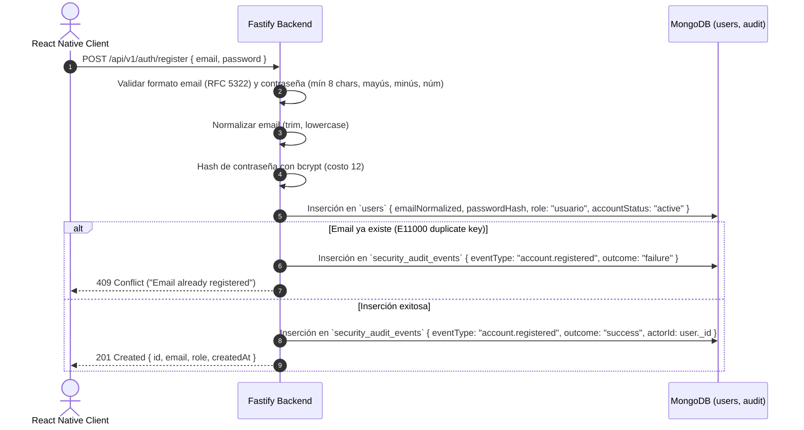
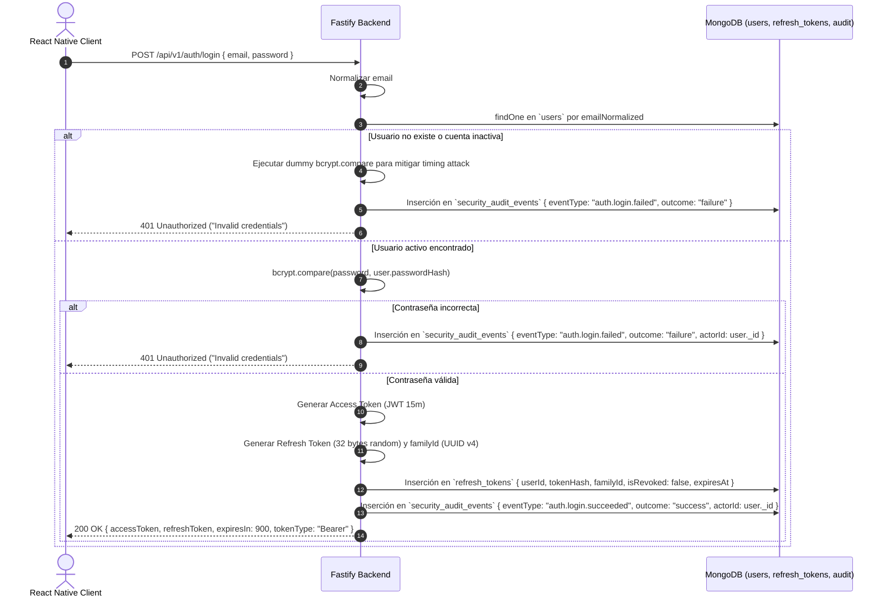
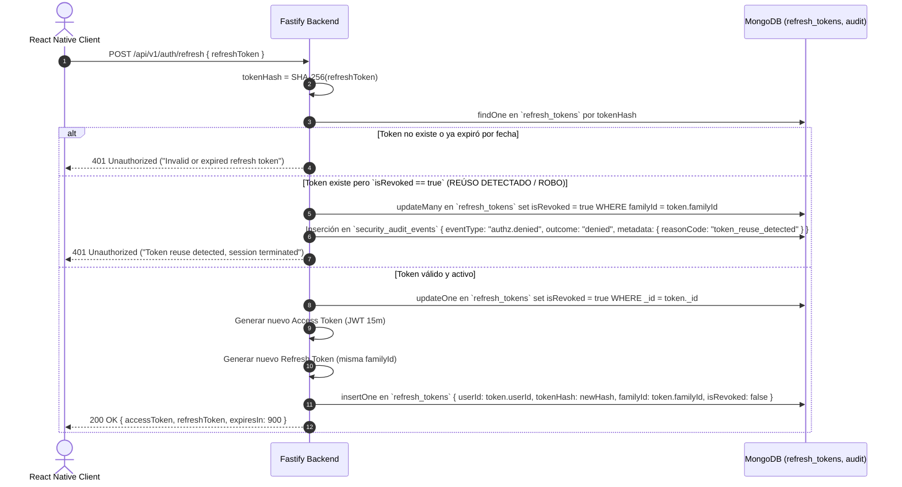

# EnlaceSeguro — Diseño de Autenticación y Autorización

**Estado:** Aprobado para implementación  
**Fecha:** 2026-10-26  
**Stack tecnológico confirmado:**
- **Backend:** Node.js 22 LTS, TypeScript 5.x, Fastify 5.x
- **Frontend móvil:** React Native
- **Persistencia:** MongoDB 8.0.x Community Server
- **Criptografía:** `bcrypt` (work factor 12), SHA-256 (hashing de tokens de refresco), JWT (HMAC-SHA256 / HS256)

---

## 1. Principios Arquitectónicos y Modelo de Amenazas

### 1.1 Invariantes Fundamentales

1. **Aislamiento de la base de datos:** El cliente React Native jamás interactúa directamente con MongoDB. Toda interacción pasa a través del gateway de Fastify.
2. **Tokens de acceso de vida corta:** El token de acceso (Access Token) es un JWT sin estado con una validez de 15 minutos ($900\text{ s}$), reduciendo la ventana de exposición ante intercepción.
3. **Tokens de refresco rotativos y opacos:** El Refresh Token es una cadena criptográficamente aleatoria de alta entropía (256 bits, codificada en base64url). Se almacena exclusivamente en MongoDB como digest criptográfico SHA-256 (`tokenHash`). Cada uso invalida el token consumido y emite un nuevo par (rotación estricta).
4. **Detección de reutilización (Token Family Tracking):** Cada familia de tokens de refresco comparte un `familyId` (UUID v4). La presentación de un token previamente revocado o consumido desencadena la revocación inmediata de toda la familia de tokens asociada a la sesión.
5. **No divulgación en fallos de autenticación:** Las respuestas ante credenciales erróneas o usuarios inexistentes devuelven un mensaje genérico idéntico (`401 Unauthorized: Invalid credentials`) con tiempo de respuesta constante para neutralizar ataques de enumeración y análisis de temporización.
6. **Mínimo privilegio en registro público:** El endpoint público de registro fuerza de forma determinista el rol `usuario`. La creación del rol `admin` queda restringida al script de aprovisionamiento por CLI/seed del servidor.
7. **Inhabilitación inmediata:** Una cuenta con `accountStatus: "disabled"` rechaza inmediatamente cualquier intento de autenticación o renovación de tokens.

---

## 2. Esquema de Persistencia: Colección `refresh_tokens`

Para soportar la rotación y revocación segura sin alterar el contrato inmutable de `users`, se introduce la colección `refresh_tokens`.

### 2.1 Contrato `$jsonSchema` (MongoDB 8.0.x)

```javascript
// database/schema/collection-validators.js (extensión)
refresh_tokens: {
  $jsonSchema: {
    bsonType: "object",
    required: [
      "_id",
      "schemaVersion",
      "userId",
      "tokenHash",
      "familyId",
      "isRevoked",
      "createdAt",
      "expiresAt"
    ],
    additionalProperties: false,
    properties: {
      _id: { bsonType: "objectId" },
      schemaVersion: { bsonType: ["int", "long", "double"], enum: [1] },
      userId: { bsonType: "objectId" },
      tokenHash: {
        bsonType: "string",
        pattern: "^[0-9a-f]{64}$",
        minLength: 64,
        maxLength: 64
      },
      familyId: {
        bsonType: "string",
        pattern: "^[0-9a-f]{8}-[0-9a-f]{4}-4[0-9a-f]{3}-[89ab][0-9a-f]{3}-[0-9a-f]{12}$",
        minLength: 36,
        maxLength: 36
      },
      isRevoked: { bsonType: "bool" },
      createdAt: { bsonType: "date" },
      expiresAt: { bsonType: "date" }
    }
  }
}
```

### 2.2 Índices Requeridos

| Índice | Tipo | Propósito |
|---|---|---|
| `{ tokenHash: 1 }` | Único | Búsqueda $O(1)$ del token presentado y garantía de unicidad. |
| `{ userId: 1 }` | Secundario | Búsqueda y revocación masiva de sesiones por usuario (p. ej., cambio de contraseña). |
| `{ familyId: 1 }` | Secundario | Revocación en cascada de la familia completa ante detección de reúso. |
| `{ expiresAt: 1 }` | TTL (`expireAfterSeconds: 0`) | Purga automática asíncrona de registros caducados por el motor de MongoDB. |

---

## 3. Estructura y Ciclo de Vida de los Tokens

### 3.1 Access Token (JWT)

- **Algoritmo:** `HS256` (HMAC con SHA-256), firmado con una clave secreta simétrica mínima de 256 bits provista por variable de entorno `JWT_SECRET`.
- **Tiempo de vida:** 15 minutos ($900\text{ s}$).
- **Formato del Payload:**

```json
{
  "iss": "enlaceseguro-api",
  "sub": "653b6f2e8f1b2c0012a4b890",
  "role": "usuario",
  "email": "usuario@ejemplo.com",
  "jti": "a6b7c8d9-e0f1-4a2b-8c3d-4e5f6a7b8c9d",
  "iat": 1729958400,
  "exp": 1729959300
}
```

### 3.2 Refresh Token

- **Formato externo:** Cadena de 43 caracteres Base64URL generada mediante 32 bytes criptográficamente seguros (`crypto.randomBytes(32).toString('base64url')`).
- **Formato en BD:** `tokenHash = crypto.createHash('sha256').update(rawToken).digest('hex')`.
- **Tiempo de vida:** 7 días ($604,800\text{ s}$).
- **Rotación:** Al invocar `/api/v1/auth/refresh`, el token actual se marca `isRevoked: true` y se genera un nuevo token con el mismo `familyId` y nueva fecha de caducidad.

---

## 4. Flujos Operativos y Diagramas de Secuencia

### 4.1 Flujo de Registro Público (`POST /api/v1/auth/register`)



### 4.2 Flujo de Inicio de Sesión (`POST /api/v1/auth/login`)



### 4.3 Flujo de Renovación y Detección de Reúso (`POST /api/v1/auth/refresh`)



### 4.4 Flujo de Cierre de Sesión (`POST /api/v1/auth/logout`)

1. El cliente envía `POST /api/v1/auth/logout` con el `refreshToken` en el cuerpo.
2. La API calcula el digest SHA-256 del token y marca el documento correspondiente como `isRevoked: true`.
3. Si se solicita logout global (`allDevices: true`), la API ejecuta `updateMany({ userId: user._id }, { $set: { isRevoked: true } })`.
4. Devuelve `204 No Content`.

---

## 5. Implementación en Fastify (Arquitectura de Plugins)

### 5.1 Integración y Decoradores de Request

Se utiliza `@fastify/jwt` junto con decoradores de ciclo de vida (`preHandler`):

```typescript
// src/plugins/auth.ts
import { FastifyInstance, FastifyRequest, FastifyReply } from 'fastify';
import fastifyJwt from '@fastify/jwt';

export interface AuthenticatedUser {
  userId: string;
  email: string;
  role: 'admin' | 'usuario';
}

declare module 'fastify' {
  interface FastifyRequest {
    user: AuthenticatedUser;
  }
  interface FastifyInstance {
    authenticate: (request: FastifyRequest, reply: FastifyReply) => Promise<void>;
    requireRole: (role: 'admin' | 'usuario') => (request: FastifyRequest, reply: FastifyReply) => Promise<void>;
  }
}
```

### 5.2 Middleware de Verificación de Autenticación (`authenticate`)

1. Extrae el encabezado `Authorization: Bearer <token>`.
2. Verifica la firma criptográfica y la expiración mediante `jwt.verify()`.
3. Asigna la carga útil tipada a `request.user`.
4. Si la validación falla, interrumpe el ciclo con `401 Unauthorized`.

### 5.3 Middleware de Autorización RBAC (`requireRole`)

1. Evalúa `request.user.role`.
2. Si la ruta requiere `admin` y el rol es `usuario`, registra el evento `authz.denied` en `security_audit_events` y aborta con `403 Forbidden`.

---

## 6. Aprovisionamiento del Administrador

La cuenta con rol `admin` no puede registrarse por la API pública. Su aprovisionamiento se gestiona mediante un comando CLI administrativo:

```bash
npm run seed:admin -- --email="admin@enlaceseguro.internal" --password="SuperSecurePassword123!"
```

El script verifica la precondición de unicidad del índice parcial sobre `users` (`{ role: 1 }` donde `role == "admin"`) garantizando que jamás coexistan múltiples administradores en el sistema.
