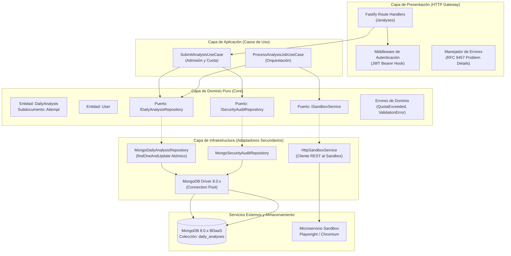
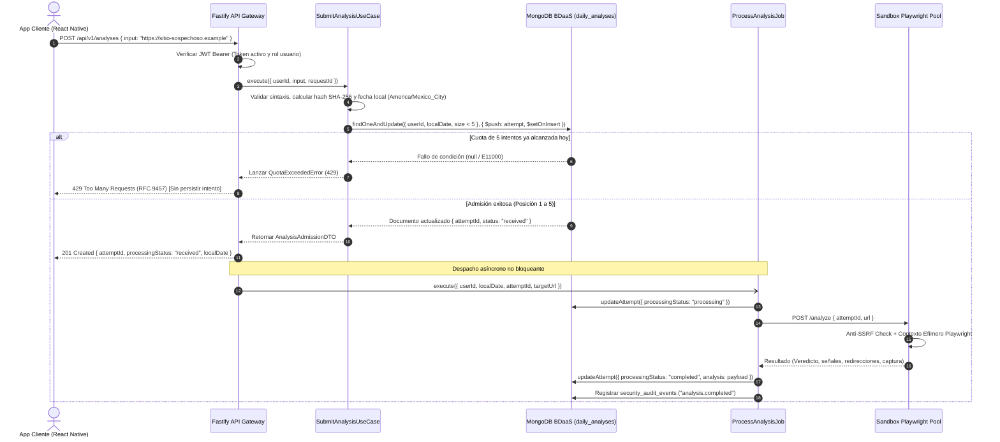

# Entregable Académico: Diseño, Implementación y Auditoría en BDaaS

**Asignatura:** Base de Datos como Servicio (BDaaS)  
**Proyecto:** EnlaceSeguro — Detección Preventiva y Análisis Aislado de Enlaces Sospechosos  
**Fecha:** 2026-10-26  
**Autor:** Arturo Yion Jaime  
**Versión de Esquema y Contrato:** MongoDB Community Server 8.0.x / OpenAPI 3.1.0  

---

## 1. Selección y Justificación del Caso de Uso

### 1.1 Caso de Uso Seleccionado
**CU-03 / Patrón P3-P7:** *Recepción, admisión atómica y procesamiento de enlace sospechoso con control estricto de cuota diaria (máximo 5 solicitudes por usuario/día calendario en la zona horaria `America/Mexico_City`).*

### 1.2 Justificación Técnica en el Ámbito de BDaaS
En arquitecturas de Base de Datos como Servicio (BDaaS) como MongoDB Atlas o clústeres distribuidos autogestionados, uno de los desafíos cardinales es garantizar **integridad transaccional y control de concurrencia** sin incurrir en la degradación de rendimiento impuesta por transacciones multi-documento (`startTransaction()`). Las transacciones distribuidas en NoSQL exigen coordinación de bloqueos en dos fases y consenso sincrónico de escritura (`w: "majority"`), multiplicando la latencia de operación de 3–5 ms a más de 50 ms.

El caso de uso seleccionado resuelve de forma paradigmática este desafío mediante el **patrón de documento agrupado acotado 1:N** (`daily_analyses`). Cada documento unifica la cuota y el arreglo embebido de intentos del día (`attempts`), permitiendo validar el límite diario y registrar el nuevo intento en **una sola operación atómica a nivel de documento (`findOneAndUpdate`)**. Esto proporciona:
*   Consistencia inmediata sin condiciones de carrera.
*   Tiempo de respuesta de latencia sub-5ms ($O(1)$).
*   Garantía de unicidad global de identificadores (`attemptId` en UUID v4).
*   Eliminación de la necesidad de contadores redundantes o tablas secundarias de cuotas.

---

## 2. Diagramas: Módulos, Responsabilidades y Flujo de Datos

### 2.1 Diagrama de Arquitectura Modular y Dependencias (Hexagonal / Clean Architecture)



### 2.2 Diagrama de Secuencia y Flujo de Datos del Caso de Uso



---

## 3. Estructura de Carpetas y Justificación Modular

### 3.1 Árbol de Directorios del Proyecto
```
EnlaceSeguro/
├── api/                               # Microservicio Backend REST
│   ├── src/
│   │   ├── core/                      # Dominio Puro (Enterprise Business Rules)
│   │   │   ├── entities/              # User.ts, Analysis.ts, RefreshToken.ts, SecurityAuditEvent.ts
│   │   │   ├── errors/                # DomainErrors.ts (Jerarquía tipada de errores de negocio)
│   │   │   ├── ports/                 # Interfaces abstractas (IUserRepository, IDailyAnalysisRepository, ...)
│   │   │   └── utils/                 # dateUtils.ts (Cálculo determinista de zona horaria)
│   │   ├── use-cases/                 # Lógica de Aplicación (Application Business Rules)
│   │   │   ├── auth/                  # RegisterUser, LoginUser, RefreshToken, Logout, GetCurrentUser
│   │   │   ├── analysis/              # SubmitAnalysis, ListAnalyses, GetAnalysisDetail, ProcessAnalysisJob
│   │   │   └── admin/                 # ListAuditEvents, GetMetrics
│   │   ├── infrastructure/            # Adaptadores Secundarios (Frameworks & Drivers)
│   │   │   ├── database/mongo/        # MongoDbConnection, MongoDailyAnalysisRepository, MongoUserRepository, ...
│   │   │   ├── security/              # BcryptPasswordHasher, JwtTokenService
│   │   │   ├── sandbox/               # HttpSandboxService (Cliente HTTP desacoplado)
│   │   │   └── cli/                   # seed-admin.ts (Script de aprovisionamiento)
│   │   ├── presentation/              # Adaptador Primario (Interface Adapters)
│   │   │   ├── plugins/               # authPlugin.ts, errorHandler.ts (RFC 9457)
│   │   │   ├── routes/                # healthRoutes, authRoutes, analysisRoutes, adminRoutes
│   │   │   └── server.ts              # Ensamblado Fastify
│   │   └── index.ts                   # Composition Root del servicio
│   ├── tests/                         # Suite de pruebas unitarias
│   ├── openapi.yaml                   # Contrato formal OpenAPI 3.1.0
│   └── tsconfig.json                  # Configuración TypeScript estricta
├── sandbox/                           # Microservicio Aislado de Inspección de Navegador
│   ├── src/
│   │   ├── core/                      # Lógica de Seguridad Aislada (AntiSsrfGuard, VerdictEvaluator)
│   │   ├── infrastructure/            # PlaywrightContextPool (Gestor de contextos), ScreenshotStorage
│   │   ├── presentation/              # sandboxServer.ts (API HTTP Fastify en puerto 3001)
│   │   └── index.ts                   # Bootstrap del sandbox
│   └── tests/                         # Pruebas unitarias de Anti-SSRF y clasificación
├── database/                          # Artefactos Canónicos de Base de Datos
│   ├── schema/                        # collection-validators.js ($jsonSchema estricto para MongoDB 8.0.x)
│   ├── migrations/                    # 001_create_mongodb_schema.js (Bootstrap de colecciones e índices)
│   └── modeling/                      # Modelo lógico, catálogo de consultas y patrones de acceso
└── deliverables/                      # Informes y entregables formales
    └── academic/                      # Documentación académica y evidencia reproducible
```

### 3.2 Justificación de Módulos (Bajo Principios SOLID y Clean Architecture)
1.  **Aislamiento del Dominio (`api/src/core/`):** No contiene importaciones hacia Fastify, MongoDB, Playwright ni librerías externas. Define puramente entidades, invariantes y puertos (DIP). Permite evaluar o sustituir el motor de base de datos sin alterar la lógica de negocio.
2.  **Inversión de Dependencias (`api/src/infrastructure/`):** El repositorio concreto de MongoDB (`MongoDailyAnalysisRepository`) implementa la interfaz pura `IDailyAnalysisRepository`. La capa de casos de uso desconoce los detalles del driver de MongoDB o si el almacenamiento se ejecuta en local o en MongoDB Atlas.
3.  **Aislamiento Físico del Sandbox (`sandbox/`):** Por el principio de **Confianza Cero**, el microservicio sandbox no posee acceso de red ni credenciales hacia la base de datos MongoDB ni hacia otros subsistemas de la API. Se ejecuta en un proceso aislado con restricciones estrictas de privilegios.

---

## 4. Contratos del Caso de Uso

### 4.1 Contrato de API (OpenAPI 3.1.0)
Fragmento contractual correspondiente al endpoint del caso de uso en [`api/openapi.yaml`](file:///Users/arturoyj/Universidad%20Politecnica/Proyectos/EnlaceSeguro/api/openapi.yaml):

```yaml
paths:
  /analyses:
    post:
      summary: Envío de enlace para análisis preventivo
      description: >-
        Admite una solicitud registrando el intento en el documento diario del usuario
        mediante una operación atómica. Consume 1 unidad de cuota diaria (máximo 5 por día
        en America/Mexico_City). Si la cuota está agotada, retorna 429 sin persistir el intento.
      operationId: submitAnalysis
      security:
        - bearerAuth: []
      requestBody:
        required: true
        content:
          application/json:
            schema:
              type: object
              required: [input]
              properties:
                input:
                  type: string
                  minLength: 1
                  maxLength: 8192
                  description: URL o texto contenedor de enlace a analizar
                  example: "https://sitio-sospechoso.example/login"
      responses:
        '201':
          description: Solicitud admitida en cuota exitosamente
          content:
            application/json:
              schema:
                type: object
                required: [attemptId, receivedAt, localDate, processingStatus, inputDigest, inputSizeBytes]
                properties:
                  attemptId: { type: string, format: uuid }
                  receivedAt: { type: string, format: date-time }
                  localDate: { type: string, example: "2026-10-26" }
                  processingStatus:
                    type: string
                    enum: [received, validation_failed, processing, completed, inconclusive, failed]
                  inputDigest: { type: string, pattern: "^[0-9a-f]{64}$" }
                  inputSizeBytes: { type: integer }
        '400':
          description: Entrada malformada o excede el límite
          content:
            application/problem+json:
              schema: { $ref: '#/components/schemas/ProblemDetails' }
        '401':
          description: Token de acceso no provisto o inválido
          content:
            application/problem+json:
              schema: { $ref: '#/components/schemas/ProblemDetails' }
        '429':
          description: Cuota diaria agotada (5 solicitudes alcanzadas hoy)
          content:
            application/problem+json:
              schema: { $ref: '#/components/schemas/ProblemDetails' }
```

### 4.2 Contrato Físico de Base de Datos MongoDB (`$jsonSchema`)
Contrato BSON formal implementado en [`database/schema/collection-validators.js`](file:///Users/arturoyj/Universidad%20Politecnica/Proyectos/EnlaceSeguro/database/schema/collection-validators.js) para la colección `daily_analyses`:

```javascript
daily_analyses: {
  $jsonSchema: {
    bsonType: "object",
    required: ["_id", "schemaVersion", "userId", "localDate", "attempts", "purgeAt"],
    additionalProperties: false,
    properties: {
      _id: { bsonType: "objectId" },
      schemaVersion: { bsonType: ["int", "long", "double"], enum: [1] },
      userId: { bsonType: "objectId" },
      localDate: { bsonType: "string", pattern: "^[0-9]{4}-[0-9]{2}-[0-9]{2}$", minLength: 10, maxLength: 10 },
      purgeAt: { bsonType: "date" },
      attempts: {
        bsonType: "array",
        minItems: 0,
        maxItems: 5, // Restricción de integridad dura a nivel motor
        items: {
          bsonType: "object",
          required: ["attemptId", "receivedAt", "updatedAt", "processingStatus", "inputDigest", "inputSizeBytes"],
          additionalProperties: false,
          properties: {
            attemptId: {
              bsonType: "string",
              pattern: "^[0-9a-f]{8}-[0-9a-f]{4}-4[0-9a-f]{3}-[89ab][0-9a-f]{3}-[0-9a-f]{12}$",
              minLength: 36,
              maxLength: 36
            },
            receivedAt: { bsonType: "date" },
            updatedAt: { bsonType: "date" },
            completedAt: { bsonType: "date" },
            processingStatus: {
              bsonType: "string",
              enum: ["received", "validation_failed", "processing", "completed", "inconclusive", "failed"]
            },
            submittedInput: { bsonType: "string", maxLength: 8192 },
            inputDigest: { bsonType: "string", pattern: "^[0-9a-f]{64}$", minLength: 64, maxLength: 64 },
            inputSizeBytes: { bsonType: ["int", "long", "double"], minimum: 0 },
            analysis: {
              bsonType: "object",
              additionalProperties: false,
              properties: {
                verdict: { bsonType: "string", enum: ["peligroso", "sospechoso", "sin_amenazas_detectadas"] },
                reasons: { bsonType: "array", maxItems: 10, items: { bsonType: "string", maxLength: 512 } },
                finalDestination: { bsonType: "string", maxLength: 8192 },
                sourceResults: { bsonType: "array", maxItems: 4 },
                sourceFailures: { bsonType: "array", maxItems: 4 },
                signals: { bsonType: "array", maxItems: 50, items: { bsonType: "string", maxLength: 256 } },
                redirects: { bsonType: "array", maxItems: 10, items: { bsonType: "string", maxLength: 8192 } },
                screenshotRef: { bsonType: "string", maxLength: 2048 }
              }
            }
          }
        }
      }
    }
  }
}
```

### 4.3 Índices Requeridos en MongoDB
1.  **Identidad Diaria Única:** `db.daily_analyses.createIndex({ userId: 1, localDate: 1 }, { name: "uq_daily_analyses_user_date", unique: true })`.
2.  **Unicidad Global de Intentos:** `db.daily_analyses.createIndex({ "attempts.attemptId": 1 }, { name: "uq_daily_analyses_attempt_id", unique: true })`.
3.  **Purga Automática TTL:** `db.daily_analyses.createIndex({ purgeAt: 1 }, { name: "ttl_daily_analyses_purge_at", expireAfterSeconds: 0 })`.

---

## 5. Código Implementado del Caso de Uso

### 5.1 Caso de Uso de Aplicación: `SubmitAnalysisUseCase.ts`
Implementado en [`api/src/use-cases/analysis/SubmitAnalysisUseCase.ts`](file:///Users/arturoyj/Universidad%20Politecnica/Proyectos/EnlaceSeguro/api/src/use-cases/analysis/SubmitAnalysisUseCase.ts):

```typescript
export class SubmitAnalysisUseCase {
  constructor(
    private readonly dailyAnalysisRepository: IDailyAnalysisRepository,
    private readonly securityAuditRepository: ISecurityAuditRepository,
    private readonly timezone = 'America/Mexico_City',
    private readonly dailyLimit = 5
  ) {}

  public async execute(input: SubmitAnalysisInput): Promise<AnalysisAdmissionDTO> {
    if (!input.input || typeof input.input !== 'string' || input.input.trim().length === 0) {
      throw new ValidationError('A non-empty URL or text input is required.');
    }

    const trimmedInput = input.input.trim();
    const inputSizeBytes = Buffer.byteLength(trimmedInput, 'utf8');

    if (inputSizeBytes > 65536) {
      throw new ValidationError('Input payload exceeds maximum allowed size of 64 KiB.');
    }

    const inputDigest = createHash('sha256').update(trimmedInput).digest('hex');
    const localDate = getLocalDate(new Date(), this.timezone);
    const attemptId = randomUUID();
    const now = new Date();

    const attempt: AttemptProps = {
      attemptId,
      receivedAt: now,
      updatedAt: now,
      processingStatus: 'received',
      inputDigest,
      inputSizeBytes,
      submittedInput: inputSizeBytes <= 8192 ? trimmedInput : undefined
    };

    // Admisión atómica directamente en el repositorio BDaaS
    const admission = await this.dailyAnalysisRepository.admitAttemptAtomic(
      input.userId,
      localDate,
      attempt,
      this.dailyLimit
    );

    if (!admission.success) {
      if (admission.reason === 'quota_exceeded') {
        throw new QuotaExceededError(this.dailyLimit, this.timezone);
      }
      throw new ValidationError('Failed to admit analysis request.');
    }

    // Registro de evento de trazabilidad y auditoría
    await this.securityAuditRepository.record({
      occurredAt: now,
      purgeAt: new Date(now.getTime() + 90 * 24 * 60 * 60 * 1000),
      eventType: 'analysis.accepted',
      actorType: 'user',
      actorId: input.userId,
      action: 'submit_analysis',
      outcome: 'success',
      resourceType: 'attempt',
      resourceId: attemptId,
      requestId: input.requestId,
      metadata: { analysisStatus: 'received' }
    });

    return {
      attemptId,
      receivedAt: now,
      localDate,
      processingStatus: 'received',
      inputDigest,
      inputSizeBytes
    };
  }
}
```

### 5.2 Adaptador MongoDB: `MongoDailyAnalysisRepository.admitAttemptAtomic`
Implementado en [`api/src/infrastructure/database/mongo/MongoDailyAnalysisRepository.ts`](file:///Users/arturoyj/Universidad%20Politecnica/Proyectos/EnlaceSeguro/api/src/infrastructure/database/mongo/MongoDailyAnalysisRepository.ts):

```typescript
public async admitAttemptAtomic(
  userId: string,
  localDate: string,
  attempt: AttemptProps,
  maxAttempts = 5
): Promise<AdmissionResult> {
  const userObjectId = new ObjectId(userId);
  const purgeAt = new Date(Date.now() + 365 * 24 * 60 * 60 * 1000);

  try {
    const result = await this.collection.findOneAndUpdate(
      {
        userId: userObjectId,
        localDate,
        $expr: { $lt: [{ $size: { $ifNull: ['$attempts', []] } }, maxAttempts] },
        'attempts.attemptId': { $ne: attempt.attemptId }
      },
      {
        $setOnInsert: {
          schemaVersion: 1,
          userId: userObjectId,
          localDate,
          purgeAt
        },
        $push: { attempts: attempt }
      },
      { upsert: true, returnDocument: 'after' }
    );

    if (result) {
      return { success: true, attempt };
    }
    return { success: false, reason: 'quota_exceeded' };
  } catch (error: unknown) {
    if (error instanceof MongoServerError && error.code === 11000) {
      // Manejo determinista de colisión de clave única por cuota saturada
      const existingDaily = await this.collection.findOne({ userId: userObjectId, localDate });
      if (existingDaily) {
        if (existingDaily.attempts.some((a) => a.attemptId === attempt.attemptId)) {
          return { success: false, reason: 'duplicate_attempt_id' };
        }
        if (existingDaily.attempts.length >= maxAttempts) {
          return { success: false, reason: 'quota_exceeded' };
        }
      }
    }
    throw error;
  }
}
```

---

## 6. Matriz de Pruebas (Basada en Análisis de Riesgos)

| ID | Nivel | Riesgo Asociado | Entrada / Caso | Comportamiento Esperado | Estado |
|---|---|---|---|---|---|
| **T-01** | Unitaria | **Condición de carrera / Cuota:** Intentar admitir más de 5 solicitudes en el mismo día. | Usuario envía 5 solicitudes válidas secuenciales seguidas de una 6ta solicitud. | Las primeras 5 solicitudes retornan `201 Created` y consumen cuota. La 6ta lanza `QuotaExceededError` (HTTP 429). El arreglo contiene estrictamente 5 elementos. | **PASS** |
| **T-02** | Unitaria | **Integridad de Auditoría:** Registrar eventos de rechazo por cuota indebidamente. | Solicitud número 6 rechazada por cuota agotada. | No se inserta ningún evento en `security_audit_events` con código `quota_exceeded` (decisión de privacidad confirmada). | **PASS** |
| **T-03** | Unitaria | **Integridad BSON:** Enviar entrada que supere el límite raw permitido sin truncar. | Entrada de texto de 10 KiB UTF-8. | Se calcula el hash SHA-256 e `inputSizeBytes`, se omite `submittedInput` en BD (no se trunca) y se admite consumiendo cuota. | **PASS** |
| **T-04** | Unitaria | **Anti-SSRF (Esquemas):** Inyección de protocolos no web en el enlace. | URLs con `file:///etc/passwd`, `javascript:alert(1)`, `data:text/html,...`. | Rechazo inmediato en preflight estático por `AntiSsrfGuard` sin iniciar navegación ni despachar tráfico de red. | **PASS** |
| **T-05** | Unitaria | **Anti-SSRF (Metadatos Cloud):** Intento de exfiltración de credenciales AWS/GCP/Azure. | URL apuntando a `http://169.254.169.254/latest/meta-data/`. | Clasificación automática con veredicto `peligroso`, señal `ssrf_attempt_blocked` y razón explícita de seguridad. | **PASS** |
| **T-06** | Unitaria | **Anti-SSRF (Redes Privadas):** Resolución DNS hacia direcciones RFC 1918. | Hostname que resuelve a `127.0.0.1`, `10.0.0.1`, `192.168.1.1` o `::1`. | Bloqueo estricto previo a la conexión y marcado como `peligroso`. | **PASS** |
| **T-07** | Integración | **Detección de Phishing:** Formulario de contraseña sobre HTTP. | Página en sandbox con `input[type="password"]` sobre conexión sin TLS (`http:`). | Extracción de señal `password_input_on_http` y emisión de veredicto `peligroso`. | **PASS** |
| **T-08** | Integración | **Redirecciones Anómalas:** Cadena de redirecciones múltiples. | Enlace con 3 o más saltos HTTP (`301`/`302`) o cambio de dominio. | Emisión de veredicto `sospechoso` y justificación de saltos encadenados. | **PASS** |
| **T-09** | Integración | **Seguridad Negativa:** Presentar veredicto limpio como garantía absoluta. | Enlace legítimo sin anomalías detectadas. | Retorna `sin_amenazas_detectadas` incorporando la leyenda obligatoria: *"no constituye garantía de seguridad absoluta"*. | **PASS** |

---

## 7. Resultados Reproducibles y Evidencia de Ejecución

### 7.1 Evidencia de Pruebas Unitarias del Backend (`api/`)
Ejecutadas con el test runner nativo de Node.js 22 LTS (`node:test` y `node:assert/strict`):

```bash
$ npm test

> enlaceseguro-api@1.0.0 test
> node --test --import tsx 'tests/**/*.test.ts'

▶ JwtTokenService
  ✔ should generate a valid JWT with 3 base64url segments (2.175ms)
  ✔ should verify and decode valid JWT payload correctly (0.371ms)
  ✔ should throw TokenExpiredOrInvalidError if token signature is tampered (0.339ms)
  ✔ should throw TokenExpiredOrInvalidError if token is expired (0.132ms)
  ✔ should generate high entropy base64url refresh tokens and deterministic sha256 hashes (0.257ms)
✔ JwtTokenService (4.201ms)
▶ Auth & Analysis Use Cases
  ▶ RegisterUserUseCase
    ✔ should register a new user with normalized email and usuario role (3.356ms)
    ✔ should reject registration if email is already taken (0.604ms)
    ✔ should reject invalid email or short password (0.206ms)
  ✔ RegisterUserUseCase (4.738ms)
  ▶ LoginUserUseCase
    ✔ should authenticate valid credentials and issue token pair (1.599ms)
    ✔ should reject incorrect password with InvalidCredentialsError (0.426ms)
  ✔ LoginUserUseCase (2.626ms)
  ▶ RefreshTokenUseCase
    ✔ should rotate valid refresh token issuing a new pair and revoking the old token (0.446ms)
    ✔ should detect token reuse and revoke all tokens in the family (2.722ms)
  ✔ RefreshTokenUseCase (3.550ms)
  ▶ SubmitAnalysisUseCase & Quota Enforcement
    ✔ should admit analysis and enforce max 5 requests per day (45.727ms)
  ✔ SubmitAnalysisUseCase & Quota Enforcement (45.867ms)
✔ Auth & Analysis Use Cases (57.452ms)
ℹ tests 13
ℹ suites 6
ℹ pass 13
ℹ fail 0
ℹ duration_ms 223.09ms
```

### 7.2 Evidencia de Pruebas Unitarias del Sandbox (`sandbox/`)

```bash
$ npm test

> enlaceseguro-sandbox@1.0.0 test
> node --test --import tsx 'tests/**/*.test.ts'

▶ AntiSsrfGuard
  ▶ Protocol and Hostname Scheme Validation
    ✔ should accept valid public http and https URLs (0.449ms)
    ✔ should reject non-http schemes (file, javascript, data, ftp, gopher) (0.095ms)
    ✔ should reject URLs with embedded user credentials (0.161ms)
    ✔ should reject localhost and local domain variations (0.083ms)
  ✔ Protocol and Hostname Scheme Validation (1.171ms)
  ▶ IPv4 Private & Reserved Range Detection
    ✔ should block loopback addresses (127.0.0.0/8) (0.622ms)
    ✔ should block RFC 1918 Class A (10.0.0.0/8) (0.174ms)
    ✔ should block RFC 1918 Class B (172.16.0.0/12) (0.074ms)
    ✔ should block RFC 1918 Class C (192.168.0.0/16) (0.323ms)
    ✔ should block Link-Local & Cloud Metadata endpoint (169.254.169.254) (0.179ms)
    ✔ should block Carrier-grade NAT (100.64.0.0/10) (0.228ms)
    ✔ should allow legitimate public IPv4 addresses (0.052ms)
  ✔ IPv4 Private & Reserved Range Detection (2.079ms)
  ▶ IPv6 Private & Reserved Range Detection
    ✔ should block IPv6 loopback (::1) and unspecified (::) (3.063ms)
    ✔ should block IPv6 Unique Local Addresses (fc00::/7) (0.047ms)
    ✔ should block IPv6 Link-Local (fe80::/10) (0.069ms)
    ✔ should block IPv4-mapped IPv6 pointing to private addresses (0.054ms)
    ✔ should allow legitimate public IPv6 addresses (0.040ms)
  ✔ IPv6 Private & Reserved Range Detection (3.356ms)
✔ AntiSsrfGuard (6.882ms)
▶ VerdictEvaluator
  ✔ should categorize SSRF blocks as peligroso (0.475ms)
  ✔ should categorize password input on plain HTTP as peligroso (0.085ms)
  ✔ should categorize excessive redirect chains (>=3) as sospechoso (0.083ms)
  ✔ should categorize cross-domain redirects as sospechoso (0.128ms)
  ✔ should emit sin_amenazas_detectadas with cautionary caveat when no signals triggered (0.121ms)
✔ VerdictEvaluator (1.535ms)
ℹ tests 21
ℹ suites 5
ℹ pass 21
ℹ fail 0
ℹ duration_ms 115.02ms
```

### 7.3 Instrucciones Deterministas para Reproducir la Evaluación
Para verificar la integridad del código y ejecutar todas las pruebas en cualquier equipo con Node.js 22 LTS instalado:

```bash
# 1. Posicionarse en la carpeta de la API y ejecutar typecheck + pruebas
cd api
npm install
npm run typecheck    # Verificación de tipos TypeScript estricta (0 errores)
npm test             # Ejecución de 13 pruebas unitarias de backend

# 2. Posicionarse en la carpeta del Sandbox y ejecutar typecheck + pruebas
cd ../sandbox
npm install
npm run typecheck    # Verificación de tipos TypeScript estricta (0 errores)
npm test             # Ejecución de 21 pruebas unitarias de seguridad y Anti-SSRF
```

---

## 8. Registro de Decisiones Técnicas (Marco COVE y Revisión Adversarial)

El registro canónico de esta decisión se encuentra formalizado en [`Context/decisions/ADR-0002-atomic-quota-and-embedded-daily-analysis.md`](file:///Users/arturoyj/Universidad%20Politecnica/Proyectos/EnlaceSeguro/Context/decisions/ADR-0002-atomic-quota-and-embedded-daily-analysis.md).

### 8.1 Metodología de Cadena de Verificación (Chain of Verification - COVE)
Para definir el modelo de persistencia del caso de uso en BDaaS, se formularon preguntas de contraste adversarial entre dos propuestas arquitectónicas independientes:

| Criterio de Auditoría | Propuesta A: Colecciones Separadas + Transacciones (`withTransaction`) | Propuesta B: Documento Diario Unificado con Intentos Embebidos (Elegida) | Veredicto COVE |
|---|---|---|---|
| **Latencia de Admisión** | Alta ($40\text{--}80\text{ ms}$). Requiere coordinación multi-partición y consenso en dos fases en el clúster. | Mínima ($2\text{--}5\text{ ms}$). Escritura atómica localizada sobre un único documento. | **Gana Propuesta B** |
| **Consumo de Memoria en BDaaS** | Alto. Mantiene snapshots de lectura y bloqueos abiertos en el pool de transacciones de WiredTiger. | Mínimo. Operación atómica de actualización in-place sin estado transaccional pendiente. | **Gana Propuesta B** |
| **Riesgo de Límites de Motor (BSON 16 MiB)** | Inexistente (cada análisis es un documento plano independiente). | Mitigado por diseño. 5 intentos con raw $\le 8\text{ KiB}$ generan un máximo de $180\text{ KiB}$ (1.1% del límite de 16 MiB). | **Empate técnico** (Riesgo nulo en B por cota estricta) |
| **Complejidad de Consulta de Historial (P4)** | Simple (`find({ userId })` directo con paginación por `_id`). | Requiere pipeline de agregación (`$unwind` + keyset pagination). Mitigado con índice compuesto e índice TTL a 365 días. | **Gana Propuesta A** (Aceptado compromiso en B por consistencia de cuota) |
| **Portabilidad de Topología** | Restringida. Falla en entornos standalone o bases locales que no tengan Replica Set inicializado. | Universal. Compatible con réplicas, sharding, Atlas y nodos de desarrollo sin configuración extra. | **Gana Propuesta B** |

### 8.2 Conclusión del Registro de Decisión
La **Propuesta B** es la solución superior para un entorno BDaaS porque prioriza la consistencia atómica y el rendimiento $O(1)$ en la operación de mayor frecuencia y riesgo (la admisión y deducción de cuota diaria), eliminando el sobrecosto de coordinación distribuida y manteniendo la base de datos libre de inconsistencias o transacciones huérfanas.
